# Nail Studio · Sistema de agendamento para estúdio de unhas

Sistema completo de agendamento feito para um estúdio de alongamento de unhas real, que antes marcava tudo à mão pelo WhatsApp. Hoje ele roda em produção com três partes trabalhando juntas:

- **Bot de WhatsApp**: a cliente agenda, consulta e cancela horários sozinha, a qualquer hora.
- **Painel da profissional**: agenda do dia, calendário, clientes e fechamento de dias, pensado para usar no celular.
- **Vitrine pública**: site com os serviços, preços e dias sem atendimento, tudo vindo da API em tempo real.

> Este repositório é um **portfólio**. O código completo não pôde ser divulgado. Aqui estão trechos escolhidos e prints com **dados fictícios** (nome do estúdio, clientes e telefones são de exemplo).

---

## Vitrine

<p>
  
  
  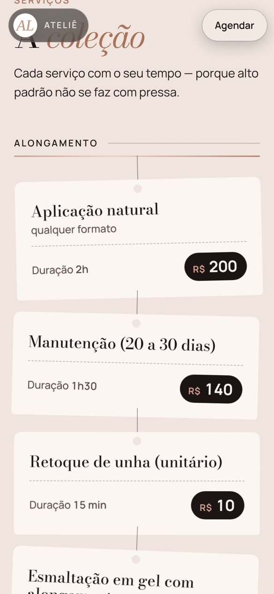
  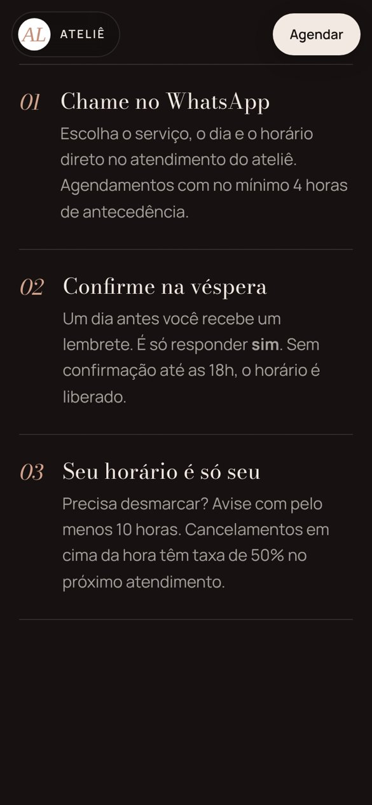
  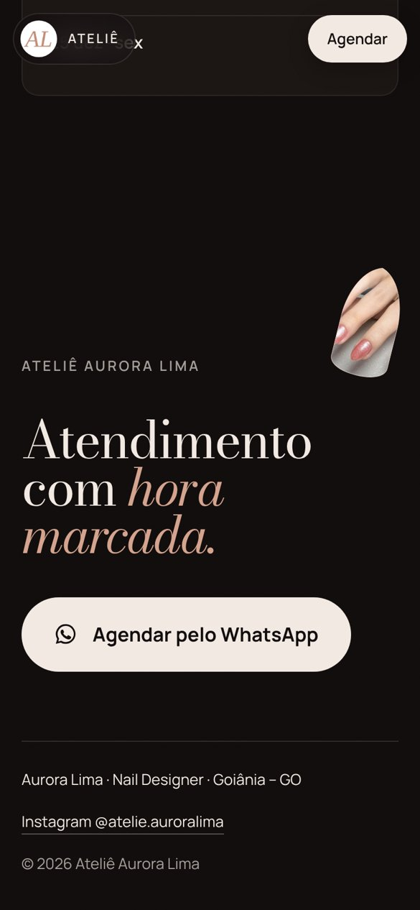
</p>

Página de uma só rolagem, mobile-first (a maioria das clientes acessa pelo celular). A seção principal é uma unha em formato amendoado que fica presa na tela e "alonga" conforme a pessoa rola, trocando os trabalhos dentro dela. Os serviços aparecem como etiquetas de boutique e a agenda mostra os próximos dias fechados, ambos buscados da API.


<p>
  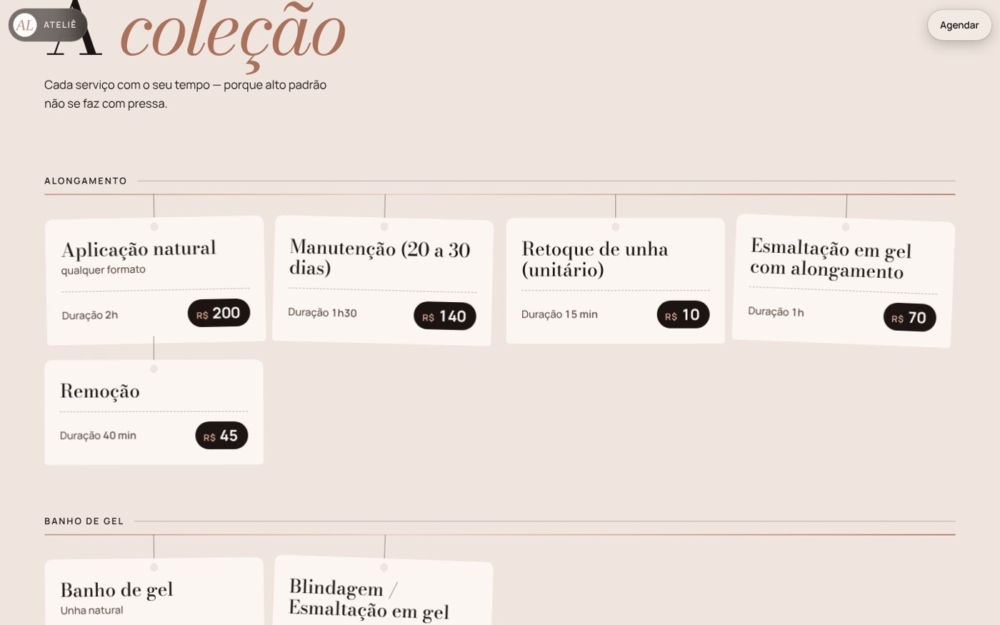
  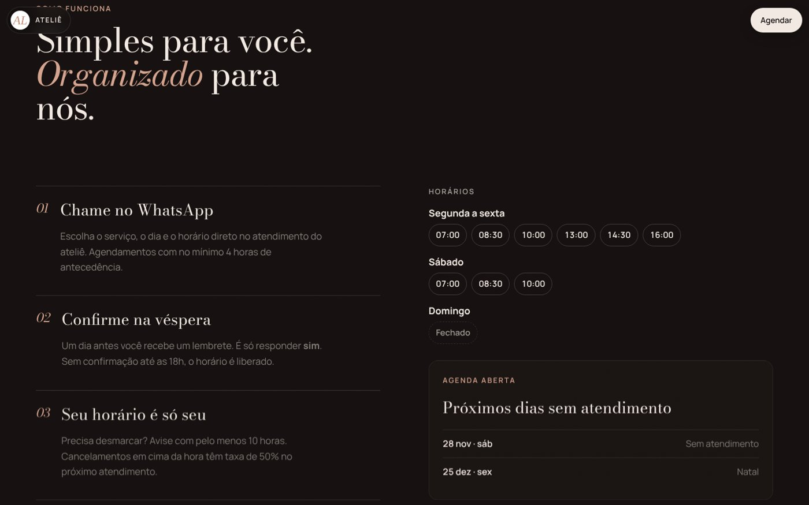
</p>

## Painel

<p>
  
  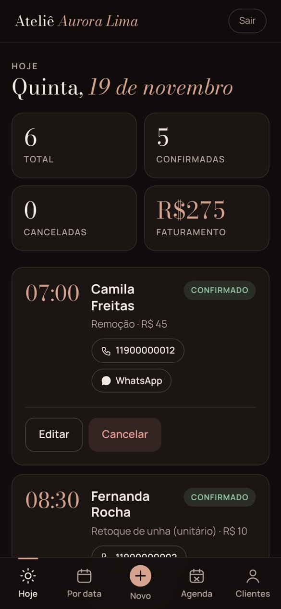
  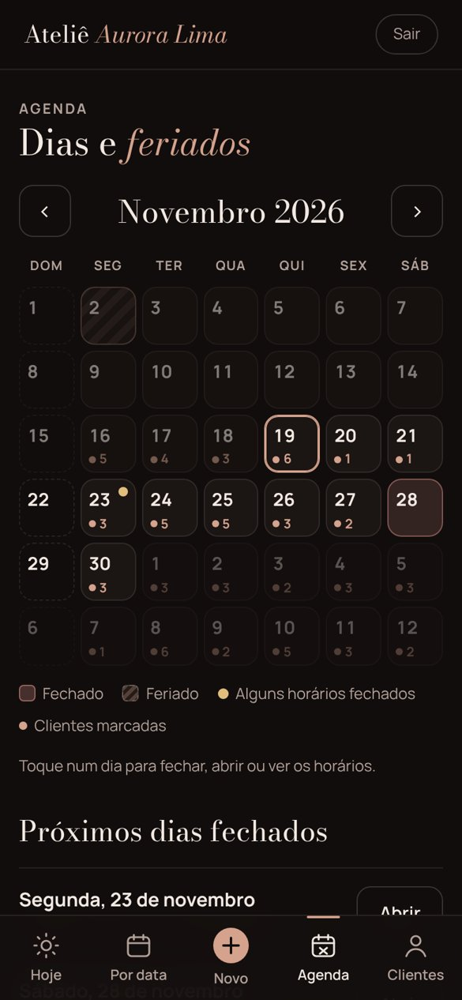
  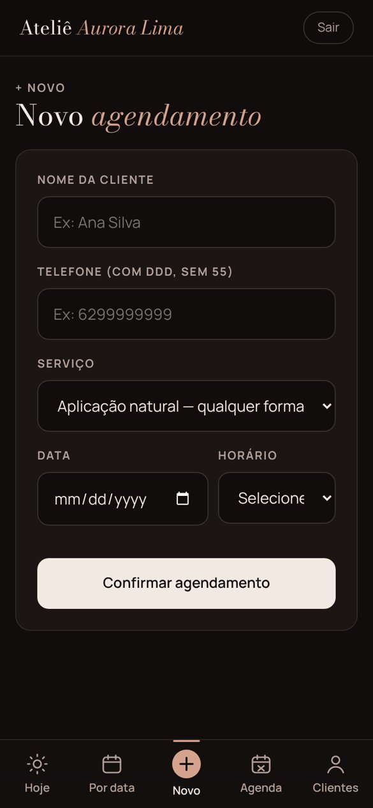
  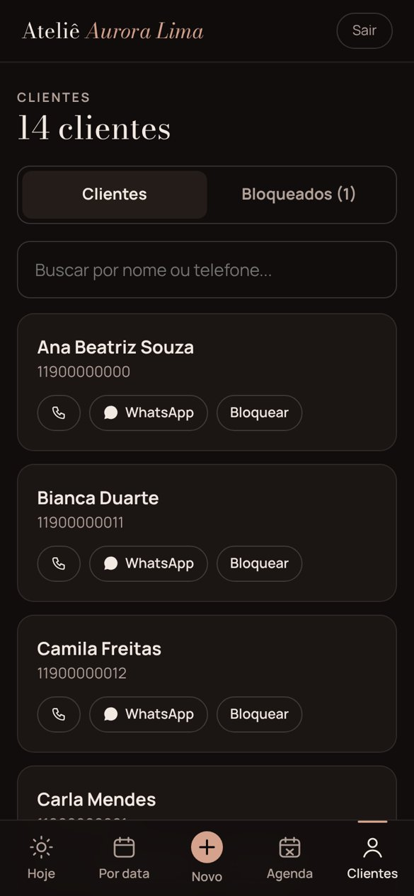
</p>

- **Hoje**: horários do dia, status (agendado/confirmado/cancelado), faturamento previsto, botões de editar, cancelar e chamar no WhatsApp.
- **Agenda**: calendário mensal para fechar um dia inteiro ou só alguns horários, e cadastrar feriados. Vale na hora para o bot e para a vitrine, sem mexer no código.
- **Novo**: agendamento manual, só com horários realmente livres.
- **Clientes**: busca, contato rápido e lista de números bloqueados (o bot ignora esses números).

No celular a navegação fica numa barra embaixo; no computador vira menu lateral.

<p>
  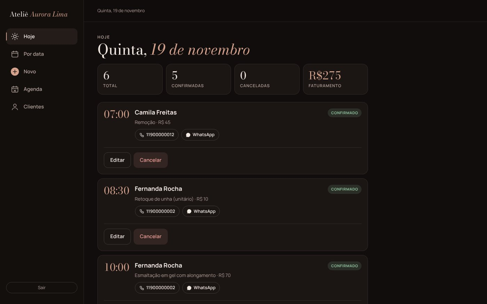
  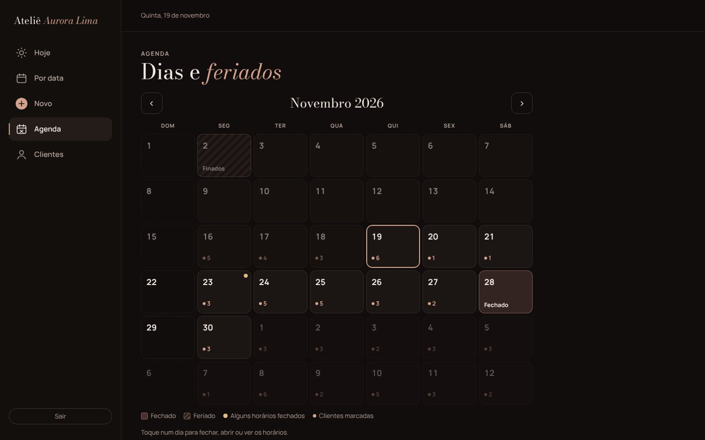
</p>

---

## Como funciona

```
 Cliente (WhatsApp)          Vitrine (site)            Profissional (painel)
        │                          │                            │
        ▼                          │                            │
  Bot Node.js ──── HTTP ────► API FastAPI ◄──── HTTP + JWT ─────┘
  whatsapp-web.js               │    ▲
        ▲                       ▼    │
        │                  PostgreSQL│
        │                            │
        └──── lembretes ──── APScheduler
```

1. A cliente manda mensagem e o bot mostra um menu: serviços, agendar, meus horários, cancelar, endereço, falar com a profissional.
2. Para agendar, ela escolhe serviço, data e um dos horários livres. A API valida tudo antes de gravar.
3. Na véspera, às 13h30, o bot pede confirmação. Quem não responder até as 18h tem o horário liberado automaticamente.
4. A profissional recebe aviso de cada novo agendamento e acompanha tudo pelo painel.

### Regras de negócio

| Regra | Onde |
|---|---|
| Horários fixos (seg–sex 6 horários, sáb 3, domingo fechado) | `api/agenda.py` |
| Feriados fixos e móveis + dias/horários fechados pelo painel | `situacao_do_dia()` |
| Mínimo de 4h de antecedência | `criar_agendamento()` |
| Uma cliente só pode ter um horário futuro por vez | `criar_agendamento()` |
| Marcou para menos de 24h? Já entra confirmado | `criar_agendamento()` |
| Confirmação na véspera até 18h, senão cancela | `api/scheduler.py` |
| Cancelamento com menos de 10h gera aviso de taxa | rota de cancelamento (não incluída) |

A mesma função `situacao_do_dia()` é usada pelo bot, pelo painel e pela vitrine. Assim um dia fechado no painel some do bot e aparece na vitrine ao mesmo tempo.

### Segurança e LGPD

- Rotas com dados de clientes exigem login do painel (JWT de 12h) **ou** chamada vinda do próprio bot (`api/auth.py`).
- Rotas públicas (vitrine) nunca expõem nomes, telefones ou o motivo interno de um dia fechado.
- Login com limite de tentativas por IP e `/docs` da API desativado em produção.
- Segredos só em variáveis de ambiente (ver `.env.example`).

### Desafio: WhatsApp e o "LID"

O WhatsApp começou a identificar alguns contatos por um ID interno (LID) no lugar do número. Como a cliente é identificada pelo telefone, isso quebrava o histórico. A solução em `bot/telefone.js` converte o LID para o número real usando a API do `whatsapp-web.js`, guarda o resultado em cache e compara números pelo DDD + 8 últimos dígitos (resolvendo o caso do 9 a mais ou a menos).

---

## Stack

| Parte | Tecnologias |
|---|---|
| API | Python, FastAPI, SQLAlchemy, PostgreSQL, APScheduler, python-jose (JWT) |
| Bot | Node.js, whatsapp-web.js, Axios |
| Painel e vitrine | HTML, CSS e JavaScript puro (sem framework), animações por rolagem |
| Deploy | Railway (API + banco), Vercel (vitrine) |

## Trechos neste repositório

```
api/
  models.py      modelos do banco
  agenda.py      regras de horário, feriados e criação de agendamento
  auth.py        JWT do painel e acesso do bot
  scheduler.py   lembrete da véspera e cancelamento automático
bot/
  fluxo-agendamento.js   etapas da conversa de agendamento
  telefone.js            normalização de telefone e resolução de LID
docs/screenshots/        prints com dados fictícios
```

---

Desenvolvido por **Luciano Alves**.
